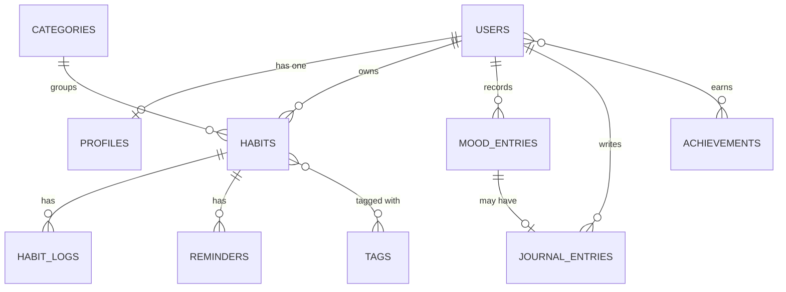

# Habitude — Habit Tracker

Habitude is a habit tracking web application built with **Laravel**, **Blade**, and **Tailwind CSS**. It is the final semester project for the *Object-Oriented Programming 2 (PBO2)* course, with a focus on designing and implementing **database table relationships** using Eloquent ORM.

## Features

- Sign up, log in, and a first-run **stepper** that sets your timezone and picks starter habits
- Track daily habits grouped into eight life categories:
  Health & Fitness, Mindfulness, Productivity, Better Sleep, Stay Hydrated, Read More, Social Connections, and Self Care
- A friendly, random **greeting** on the dashboard that follows your open habits ("Ready to hit the gym?", "Ready to read a few pages?"), the time of day, and your streak
- Daily check-ins with a spring checkbox, +1 progress, and a **timer** for habits measured in minutes
- A year **skyline** on the home page: a GitHub-style heat map of your check-ins that folds into a 3D city (one orange, fainter when you did less), with year total, busiest day, and longest and current **streaks**; click a day to open it
- A month **calendar** that shades each day by completion
- **Mood check-in** for each day (1–5 hearts)
- **Daily journal** that can be linked to the day's mood
- Habit reminders with custom time and weekdays, switched on and off with a ringing **bell toggle**, and listed on the dashboard
- Tags for flexible habit organization
- Achievements and badges (for example, a 7-day streak)
- Dashboard with today's habits, streaks, and per-category progress (a Has-Many-Through query)
- **Today's habits** shows five rows by default (you can pick 5, 8, 10 or all, and it is remembered), with an All / To do / Done filter
- Habits as a grouped **list or grid** (Finder style) with swipe-to-edit rows
- Mobile **dock** navigation
- Animated profile pictures: a unique drifting orange **waves** avatar per user, generated on the server (no upload needed)

## Two Sides: Beta app and Admin console

| | Beta app (`/`) | Admin console (`/admin`) |
|---|---|---|
| For | Everyone who signs up | Administrators only |
| Label | **BETA** badge and a "preview, not production" bar | **ADMIN** badge and an "affects every user" bar |
| Does | Habits, check-ins, calendar, streaks, mood, journal, reminders | System overview, users and roles, categories, tags, achievements |

- The release label comes from `HABITUDE_STAGE` in `.env` (`beta` by default). Set it to `production` to hide the badge and the preview bar.
- Make someone an admin with `php artisan habitude:make-admin email@example.com` (add `--revoke` to undo).
- No admin account yet on a database that already has data? Run `php artisan db:seed --class=AdminSeeder`. It never deletes anything; credentials come from `ADMIN_EMAIL` / `ADMIN_PASSWORD` in `.env` (default `admin@example.com` / `password`).
- Regular users get a 403 on every `/admin` page.

## Database Design

The full schema and every relationship are documented with Mermaid diagrams in
[`docs/database/erd.md`](docs/database/erd.md).



### Relationships Covered

| Type | Example |
|---|---|
| One-to-One | `User` ↔ `Profile`, `MoodEntry` ↔ `JournalEntry` |
| One-to-Many | `User` → `Habit`, `Category` → `Habit`, `Habit` → `HabitLog` |
| Many-to-Many | `Habit` ↔ `Tag` |
| Many-to-Many with pivot data | `User` ↔ `Achievement` (`earned_at`) |
| Has-Many-Through | `User` → `HabitLog` through `Habit` |

## Tech Stack

- PHP 8.3+ and Laravel
- Blade templates
- Tailwind CSS v4 (via Vite) with the Brex-style design tokens, Inter font, a shadcn sidebar-08 style layout, and plain JavaScript ports of React Bits micro-interactions (no frontend framework)
- MySQL (SQLite is used for automated tests)
- Laravel MCP for AI-assisted development

## Getting Started

```bash
# Clone the repository
git clone https://github.com/dzakwannajmi/PBO2_LARAVEL_5C.git
cd PBO2_LARAVEL_5C

# Install dependencies (includes the DiceBear avatar library)
composer install
npm install

# Configure the environment
cp .env.example .env
php artisan key:generate

# Create the schema and seed the categories (see Database Setup below)
php artisan migrate --seed

# Start the development servers
npm run dev
php artisan serve
```

Then open <http://localhost:8000>.

## Database Setup

The app uses **MySQL**, as in the course module.

1. Start MySQL (XAMPP, Laragon, or Homebrew) and create an empty database:
   ```sql
   CREATE DATABASE habitude CHARACTER SET utf8mb4 COLLATE utf8mb4_unicode_ci;
   ```
2. In `.env`, check the connection (already the default in `.env.example`):
   ```
   DB_CONNECTION=mysql
   DB_HOST=127.0.0.1
   DB_PORT=3306
   DB_DATABASE=habitude
   DB_USERNAME=root
   DB_PASSWORD=
   ```
3. Create the tables and sample data, and re-run it any time to reset everything:
   ```bash
   php artisan migrate:fresh --seed
   ```
4. Inspect the tables and foreign keys in phpMyAdmin or HeidiSQL.
5. Log in with a demo account (password `password` for both), or register a new one to see the stepper:
   - **`test@example.com`**: a regular user with 45 days of sample data
   - **`admin@example.com`**: an administrator for the console at `/admin`

Automated tests (`php artisan test`) use an in-memory SQLite database, so they never touch your MySQL data.

## Progress

Phase progress (P01, P02, ...) broken into jobs (J1, J2, ...) with proof, status, and completion dates: [`docs/progress`](docs/progress/P01-database-design.md).

## Tests

```bash
php artisan test   # 74 tests, in-memory SQLite
```

## Contributing / Forking

New to forking the course repository? See the step-by-step guide for Windows and macOS (in Indonesian): [`docs/guides/fork-guide.md`](docs/guides/fork-guide.md).

## Project Structure

```
app/Models/        Eloquent models and relationships
app/Http/Controllers/  Controllers (dashboard, habits, mood, journal, achievements, auth, ...)
app/Services/      Streaks, calendar, and achievement rules
database/
  migrations/      Table definitions
  factories/       Fake data generators
  seeders/         Categories and sample data
resources/views/   Blade templates (components/app-layout is the sidebar layout)
resources/js/ui/   Vanilla ports of the React Bits interactions
docs/
  database/        ERD and relationship documentation
  guides/          Fork and Git workflow guide
  progress/        Phase tracker (P01, P02, ...)
```

## Roadmap

- [x] Database design and documentation
- [x] Migrations, models, factories, and seeders
- [x] CRUD pages for categories, tags, and habits (Blade + Tailwind, sidebar layout)
- [x] Authentication and onboarding stepper
- [x] Dashboard with calendar, streaks, and category progress
- [x] Mood and journal
- [x] Reminders and achievements
- [x] UI kit: branched menu, glide select, swipe row, spring check, peek rating, counter, stepper, dock
- [x] Admin console and Beta release stage
- [ ] Run and verify on MySQL

## Author

Muhammad Dzakwan Najmi — NPM 2410010454 — TI 5C REG BJB

## License

Released under the [MIT License](https://opensource.org/licenses/MIT).

Interaction designs are ports of [React Bits](https://reactbits.dev) micro-interactions; check its license terms before publishing the project publicly.

Profile pictures use the [DiceBear](https://www.dicebear.com) *Waves* style, released under [CC0 1.0](https://creativecommons.org/publicdomain/zero/1.0/); the PHP library `dicebear/core` is MIT.
